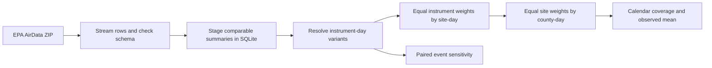

# Urban PM2.5 Monitoring Coverage Audit

Audit how many days available PM2.5 observations cover in each reported AQS county, how the estimates depend on nearby instruments, and what changes on instrument-days with both included and excluded exceptional-event summaries.

## Results

The 2023 archive contained **847,162** EPA rows. After selecting the daily AQS aggregate, deduplicating and grouping, the audit found **452,388 instrument-days**, **306,422 site-days** and **201,525 county-days** in **636 AQS regions**. **144** regions had every calendar day covered and **87** had fewer than half. Of **139** matched exceptional-event pairs, **131** had a nonzero concentration difference, with a mean absolute difference of **6.312 µg/m³** across those pairs. Pair availability depends on the provider publishing both summaries.

The downloadable local report allows filtering by county, state and AQS ID. The artifact folder includes annual and monthly CSVs, paired event sensitivity, a SQLite database and a machine-readable run report. [Run evidence](reports/2023-summary.json)

## Data and method

EPA AirData parameter 88101, 2023 daily aggregate release. The selected summaries use the label `PM25 24-hour 2012`, measured in µg/m³ at local conditions. [Source and cleaning](data/README.md)



An AQS instrument is a site plus a POC for the fixed pollutant. The SQL collapses equal duplicate variants, keeps a consistent baseline within each method and selects `24 HOUR` over `24-HR BLK AVG` when both are eligible. A baseline row either includes the event or has no event. The sensitivity analysis uses only the same instrument, method, local day and duration and computes excluded minus included. Reports count distinct observed days and include zero-observation months for every source region in scope. A county concentration mean gives equal weight to observed county-days, after giving equal weight to sites within each day.

## Installation and reproduction

Use Python 3.11 or newer with the bundled SQLite module. This project has no third-party dependencies.

```sh
python audit.py fetch --year 2023 --archive data/raw/daily_88101_2023.zip --sha256 4b40502e8147419643a1120c666c4aa952633094f21f65475844172bcc78833b
python audit.py audit --year 2023 --archive data/raw/daily_88101_2023.zip --sha256 4b40502e8147419643a1120c666c4aa952633094f21f65475844172bcc78833b --out runs/2023
python -m unittest discover -s tests -v
```

Open `runs/2023/coverage.html`. The SHA-256 check detects provider updates. For a newer release, document its date and SHA-256 before rerunning. Run separate processes in separate output directories. The annual coverage denominator follows the civil calendar, including leap days.

## Experiments and limitations

The report quantifies calendar coverage, reporting sites, the available-observation mean and the change in matched event summaries. AQS station siting, scope and operating schedules affect all four. County code membership comes from available records and includes AQS geographic entities. Counties absent from the source are outside the reported set. Coverage is a reporting diagnostic and the concentration summaries are unweighted by population. Missing dates are unfilled. A scheduled-day analysis would require monitoring schedules and aggregation rules at instrument level. Comparison of historical periods should first confirm matching fields and sampling designs.

## License

MIT for project code. EPA AirData is credited separately. [EPA documentation](https://aqs.epa.gov/aqsweb/airdata/FileFormats.html) · [EPA data-use terms](https://www.epa.gov/outdoor-air-quality-data/do-i-need-request-permission-use-monitoring-data-and-graphics-airdata)
